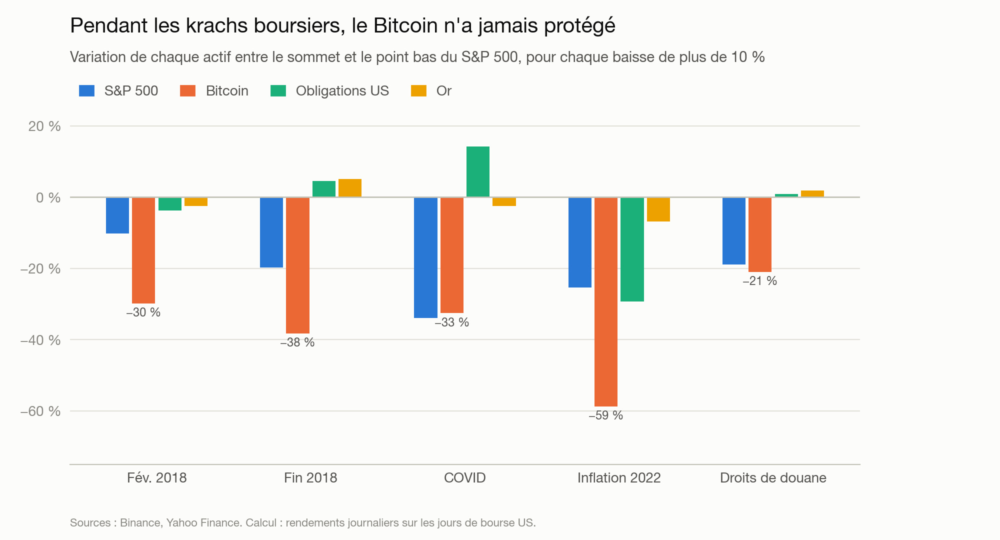
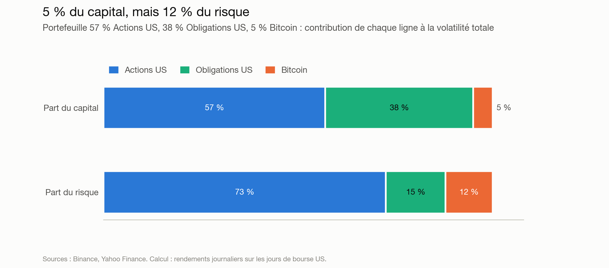

# La crypto est-elle devenue un actif comme les autres ?

Analyse des liens entre les cryptomonnaies (Bitcoin, Ethereum, Solana) et les marchés
traditionnels (actions, obligations, or) depuis 2018 : corrélations, volatilité,
comportement pendant les crises, et place de la crypto dans un portefeuille diversifié.

## La réponse en bref

**La crypto est devenue un actif lié aux marchés, mais pas un actif comme les autres.**

| Critère | Verdict |
|---|---|
| Lien avec la bourse | **Oui depuis 2020** : le Bitcoin bouge en partie avec la bourse américaine (corrélation autour de 0,4, contre 0 avant) |
| Volatilité | **Encore à part** : divisée par deux depuis 2021, mais toujours plus de 2 fois celle du Nasdaq |
| Protection en crise | **Non** : il a baissé pendant chacun des 5 krachs du S&P 500, souvent bien plus fort, et a en plus ses propres krachs |
| « Or numérique » | **Non** : aucun lien avec l'or dans les données (corrélation autour de 0,1) |




L'analyse complète, avec tous les graphiques et les chiffres, est dans le notebook
[`notebooks/01_analyse.ipynb`](notebooks/01_analyse.ipynb).

## Et dans un portefeuille ?

**Sur 2018-2026, 5 % de Bitcoin ont amélioré un portefeuille classique 60 % actions / 40 % obligations,
au prix de chutes plus profondes.**

| Question | Réponse |
|---|---|
| Le rendement ajusté du risque s'améliore-t-il ? | **Oui** : ratio de Sharpe de 0,48 à 0,59 |
| Est-ce juste plus de risque ? | **Non** : à volatilité égale, il fait mieux que d'ajouter des actions (9,6 % contre 8,7 % par an) |
| Les chutes sont-elles pires ? | **Oui**, systématiquement : la volatilité sous-estime ce risque |
| Combien de risque pour 5 % de capital ? | Environ **12 %** du risque total |
| Le résultat dépend-il de la date de départ ? | **Non**, sur 70 périodes de 3 ans testées |
| Dépend-il du rendement futur du Bitcoin ? | **Assez peu**, tant qu'il ne perd pas plus de ~7 % par an et qu'on rééquilibre |




Détails, tests de robustesse et limites dans [`notebooks/02_portefeuille.ipynb`](notebooks/02_portefeuille.ipynb).
Ce n'est pas un conseil d'investissement : l'analyse porte sur un actif qui a survécu et fortement
monté (biais du survivant), sur moins de 9 ans d'histoire.

## Avancement

- [x] **1. Pipeline de collecte** : prix journaliers via Binance et Yahoo Finance, stockés dans DuckDB
- [x] **2. Qualité et transformation** : alignement crypto 7j/7 et bourse 5j/7, modèles SQL avec dbt, 34 tests
- [x] **3. Analyses** : rendements, volatilité, drawdowns, corrélations glissantes, crises
- [x] **4. Simulation de portefeuille** : ajout de crypto à un portefeuille 60/40, rééquilibrage, frais, tests de robustesse
- [x] **5. Dashboard Streamlit** + mise à jour quotidienne automatique (GitHub Actions)
- [x] **Bonus : cryptomonnaies tendance** : photo quotidienne du classement CoinGecko, historisée
- [ ] **Mise en ligne** : dépôt GitHub public, puis déploiement sur Streamlit Community Cloud (voir plus bas)

## Dashboard interactif

Cinq sections : vue d'ensemble avec les indicateurs du jour, lien avec la bourse (corrélations glissantes
au choix), risque et krachs (seuil réglable), **simulateur de portefeuille** (part d'actions, actif ajouté,
part de crypto, rééquilibrage, date de départ, frais) et **cryptomonnaies tendance** (les 15 plus
recherchées du jour sur CoinGecko, depuis combien de jours chacune est en tendance, et les plus fréquentes
sur 30 jours).

Le dashboard est disponible **en français et en anglais** : boutons FR | EN en haut à droite, ou
`?lang=en` à la fin de l'adresse, pour partager directement la version anglaise.

```bash
streamlit run app/streamlit_app.py
```

### Architecture

```
GitHub Actions (chaque jour, 6h30 UTC)
  collecte ──▶ dbt build (42 modèles et tests) ──▶ export Parquet ──▶ branche `data`
                        │                                                │
                        └── un test échoue : rien n'est publié           ▼
                                                          Streamlit Community Cloud
                                                          (lit les Parquet via DATA_URL)
```

- La base DuckDB n'est pas versionnée. Le dashboard lit un **export Parquet** des tables finales
  (moins de 1 Mo au total), publié sur une branche `data` **réécrite à chaque fois** : l'historique Git
  du projet ne grossit pas avec les mises à jour quotidiennes.
- **Les tests qualité protègent le dashboard** : si un test dbt échoue (données manquantes, prix
  incohérents...), le workflow s'arrête avant la publication et le dashboard garde les données de la veille.
- **Historique des tendances** : CoinGecko ne donne que le classement du moment. Chaque jour, le
  workflow récupère l'historique publié la veille sur la branche `data` (`raw_trending.parquet`),
  y ajoute la photo du jour, puis republie le tout. L'historique s'allonge ainsi d'un jour à chaque passage.
- En local, le dashboard lit directement la base DuckDB, avec exactement les mêmes calculs
  (`src/analysis/`) que les notebooks.

### Mise en ligne

1. Créer un dépôt **public** sur GitHub et y pousser le projet.
2. Onglet **Actions** → « Mise à jour des données » → **Run workflow**. Le premier passage crée la branche `data`.
3. Sur [share.streamlit.io](https://share.streamlit.io) → **Create app** : choisir le dépôt, la branche `main`
   et le fichier `app/streamlit_app.py`. Dans **Advanced settings**, choisir Python 3.11 et ajouter le secret :
   ```toml
   DATA_URL = "https://raw.githubusercontent.com/<utilisateur>/<depot>/data"
   ```
4. Ajouter le lien du dashboard en haut de ce README.

## Actifs suivis

| Symbole | Actif | Classe | Source |
|---|---|---|---|
| BTC, ETH, SOL | Bitcoin, Ethereum, Solana | crypto | Binance (paires USDT) |
| SPX | S&P 500 | action | Yahoo Finance (`^GSPC`) |
| NDX | Nasdaq Composite | action | Yahoo Finance (`^IXIC`) |
| CAC | CAC 40 | action | Yahoo Finance (`^FCHI`) |
| TLT | Obligations US 20 ans+ (ETF) | obligation | Yahoo Finance |
| GOLD | Or (contrat future) | matière première | Yahoo Finance (`GC=F`) |
| SPY | S&P 500 (ETF, dividendes réinvestis) | action | Yahoo Finance |
| GLD | Or (ETF) | matière première | Yahoo Finance |
| BIL | Bons du Trésor US 1-3 mois (ETF) | monétaire | Yahoo Finance |

S'y ajoutent les **cryptomonnaies tendance** : les 15 plus recherchées sur CoinGecko sur 24 heures
([API publique](https://docs.coingecko.com/reference/trending-search), sans clé), relevées une fois par jour.
CoinGecko plutôt que CoinMarketCap : les conditions d'utilisation de CoinMarketCap interdisent la
récupération automatique de son site, et son API gratuite ne donne pas les tendances.

Les indices (S&P 500, Nasdaq, CAC 40) servent à l'analyse des marchés. Les simulations de portefeuille
utilisent des ETF réellement achetables : l'indice `^GSPC` n'inclut pas les dividendes, ce qui
sous-estimerait les actions d'environ 1,5 % par an. BIL sert de placement sans risque pour le ratio de Sharpe.

La liste se modifie dans [`src/config.py`](src/config.py).

## Installation

```bash
python3 -m venv .venv
source .venv/bin/activate
pip install -r requirements.txt
```

## Utilisation

```bash
python -m src.ingest                 # collecte (incrémentale si la base existe déjà)
python -m src.ingest --full-refresh  # re-télécharge tout l'historique
python -m src.check                  # résumé qualité, actif par actif
python -m src.export                 # export Parquet des tables finales (après dbt build)
```

La base est créée dans `data/market.duckdb`. Ensuite, on construit et on teste les tables d'analyse :

```bash
cd transform
dbt build              # construit tous les modèles et lance tous les tests
dbt source freshness   # vérifie que la collecte a tourné récemment
```

Enfin, on régénère les notebooks et leurs graphiques (dans `reports/figures/`) :

```bash
cd notebooks
for nb in 01_analyse 02_portefeuille; do
  jupytext --to ipynb $nb.py
  jupyter nbconvert --to notebook --execute --inplace $nb.ipynb
done
```

Chaque notebook est versionné sous deux formes : le `.py`, source lisible et facile à relire
dans Git, et le `.ipynb`, version exécutée avec ses résultats, affichée directement par GitHub.

## Structure

```
src/                         # collecte (Python)
├── config.py                # actifs, dates, chemins
├── db.py                    # schéma DuckDB et écriture
├── ingest.py                # point d'entrée de la collecte
├── check.py                 # résumé qualité rapide
├── export.py                # export Parquet pour le dashboard en ligne
├── ingestion/
│   ├── binance.py           # API publique Binance (sans clé)
│   ├── coingecko.py         # cryptomonnaies tendance, API publique CoinGecko (sans clé)
│   └── yahoo.py             # Yahoo Finance via yfinance
└── analysis/
    ├── data.py              # lecture des tables dbt
    ├── metrics.py           # rendement, volatilité, Sharpe, drawdowns, corrélations, krachs
    ├── portfolio.py         # simulation de portefeuille, rééquilibrage, frais, tests de robustesse
    └── charts.py            # graphiques (une couleur fixe par actif)

notebooks/
├── 01_analyse.py / .ipynb       # la crypto face aux marchés : risque, lien, crises
└── 02_portefeuille.py / .ipynb  # faut-il ajouter de la crypto à un portefeuille 60/40 ?

reports/figures/             # graphiques générés par les notebooks

app/                         # dashboard Streamlit
├── streamlit_app.py         # les cinq sections et le simulateur
├── plots.py                 # graphiques interactifs (Plotly), mêmes couleurs que les notebooks
├── langue.py                # français / anglais : textes, nombres, dates
└── requirements.txt         # dépendances du dashboard seul, pour l'hébergement

.github/workflows/
└── update-data.yml          # mise à jour quotidienne : collecte, dbt, export, publication

transform/                   # transformation (dbt + SQL)
├── models/
│   ├── staging/             # nettoyage des données brutes
│   ├── intermediate/        # calendrier commun
│   └── marts/               # tables prêtes pour l'analyse
├── tests/                   # tests qualité spécifiques au projet
└── macros/
```

## Modèle de données

```
raw (collecte Python)       staging (vues)        marts (tables)
─────────────────────       ──────────────        ──────────────────────
raw.assets ───────────────▶ stg_assets ─────────▶ dim_assets
raw.prices ───────────────▶ stg_prices ──┬──────▶ fct_daily_returns
                                         │
                   int_reference_calendar┴──────▶ fct_aligned_returns
raw.trending ─────────────▶ stg_trending ───────▶ fct_trending
```

| Table | Contenu | Usage |
|---|---|---|
| `marts.dim_assets` | Un actif par ligne, période d'historique, facteur d'annualisation (365 ou 252) | Référentiel |
| `marts.fct_daily_returns` | Rendements de chaque actif sur **son propre calendrier** | Étudier un actif seul |
| `marts.fct_aligned_returns` | Rendements de tous les actifs sur le **calendrier de la bourse US** | Comparer des actifs |
| `marts.fct_trending` | Cryptomonnaies tendance jour par jour, avec jours en tendance et série de jours consécutifs (méthode « gaps and islands ») | Onglet tendances |

## Tests qualité

34 tests tournent à chaque `dbt build`, dont :

- **Unicité** d'une ligne par (actif, date) à chaque étape
- **Cohérence des prix** : prix positif, clôture comprise entre le plus bas et le plus haut du jour
- **Aucun jour manquant en crypto** (elle cote 7j/7)
- **Aucun trou anormal en bourse** : au plus 5 jours sans cotation (le cas de Pâques à Paris)
- **Grille alignée complète** : chaque jour du calendrier a une ligne pour chaque actif existant
- **Alertes** (sans bloquer) : variation de plus de 50 % en un jour, prix repris depuis plus de 4 jours
- **Classement des tendances complet** : une ligne par cryptomonnaie et par jour, positions 1 à N sans trou
- **Fraîcheur** : alerte si la collecte des prix n'a pas tourné depuis 3 jours, ou celle des tendances depuis 2

Le test sur les trous de cotation a d'abord levé 11 alertes. Ce n'étaient pas des erreurs : Paris ferme
le Vendredi saint et le lundi de Pâques, ainsi que les 25 et 26 décembre. Le seuil est passé de 4 à 5 jours.

## Choix techniques

- **DuckDB** : base SQL analytique dans un simple fichier, sans serveur à installer.
- **Collecte idempotente** : chaque ligne est identifiée par `(symbol, date)`. Relancer la collecte
  remplace les lignes existantes au lieu de créer des doublons.
- **Mise à jour incrémentale** : seuls les derniers jours sont re-téléchargés. Les 5 derniers jours
  sont toujours écrasés pour corriger une bougie incomplète ou une révision de la source.
- **Journées terminées uniquement**, sur les deux sources : pendant la séance, le prix du jour bouge encore.
- **Simulations honnêtes** : frais de 0,1 % à chaque rééquilibrage, ratio de Sharpe calculé au-dessus
  du rendement du cash (et non de 0), comparaison à risque égal, rejeu sur toutes les périodes de 3 ans,
  et test « et si le Bitcoin rapportait moins ? » pour mesurer la dépendance au passé.
- **Krachs détectés automatiquement** à partir des données (baisse de plus de 10 % du S&P 500 depuis
  un sommet), plutôt que choisis à la main : on évite de ne retenir que les épisodes qui arrangent.
- **Schémas séparés** dans la base (`raw`, `staging`, `intermediate`, `marts`) : on sait toujours
  si une table est brute ou prête pour l'analyse.
- **Prix brut et prix ajusté** côté Yahoo : `adj_close` tient compte des dividendes (important
  pour l'ETF obligataire TLT), `close` sert aux contrôles de cohérence.
- **Une source en panne ne bloque pas les autres** : l'erreur est signalée et le script se termine
  avec un code d'échec, utile pour l'automatisation. Une panne de CoinGecko, elle, ne bloque pas la
  mise à jour des prix : l'historique des tendances reste simplement inchangé ce jour-là.
- **Une photo par jour, remplacée en bloc** : relancer la collecte le même jour remplace le classement
  du jour au lieu de le compléter, pour ne jamais mélanger deux classements.

## Le problème de l'alignement crypto / bourse

La crypto cote **100 %** des jours calendaires, la bourse environ **69 %** (ni week-end, ni jours
fériés), et les jours fériés diffèrent entre Paris et New York. Comparer les deux demande un choix
explicite. Trois méthodes sont possibles :

| Méthode | Principe | Défaut |
|---|---|---|
| **A. Calendrier commun** (retenue) | Jours de bourse US ; le rendement crypto du lundi couvre vendredi → lundi | Aucun pour la comparaison |
| B. Jointure naïve | Rendements de chaque actif joints sur la date | Les mouvements crypto du samedi et du dimanche disparaissent |
| C. 7j/7 recopié | Prix des actions recopié le week-end | Rendements nuls inventés pour les actions |

**Ce que ça change concrètement**, mesuré sur les données 2018-2026 :

- La méthode B **sous-estime la volatilité du Bitcoin** : 59 % par an au lieu de 65 %.
- La méthode C **sous-estime la volatilité du S&P 500** de 17 % (16 % au lieu de 19 %) si on
  l'annualise sur 252 jours, comme d'habitude pour une action.
- Sur toute la période, la corrélation BTC / S&P 500 varie peu (0,29 à 0,32). Mais sur une fenêtre
  glissante de 90 jours, l'écart entre A et B atteint **0,18 en mars 2020**, pendant le krach COVID.
  Les erreurs d'alignement faussent donc les résultats précisément pendant les crises,
  là où ce projet cherche des réponses.

**Limite connue** : les heures de clôture ne sont pas identiques (00:00 UTC pour Binance, environ
21:00 UTC pour New York, 16:30 UTC pour Paris). Le décalage de 3 heures avec New York est négligeable
en données journalières ; celui avec Paris l'est moins et sera gardé en tête pour le CAC 40.
