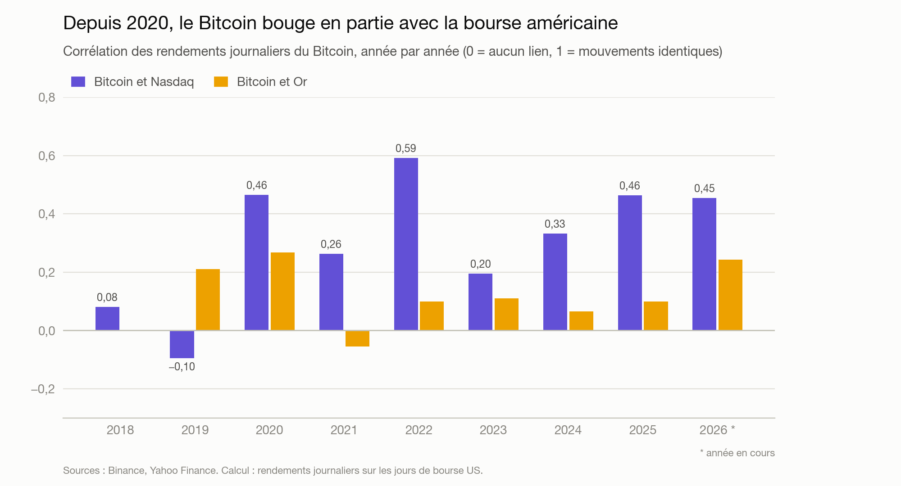
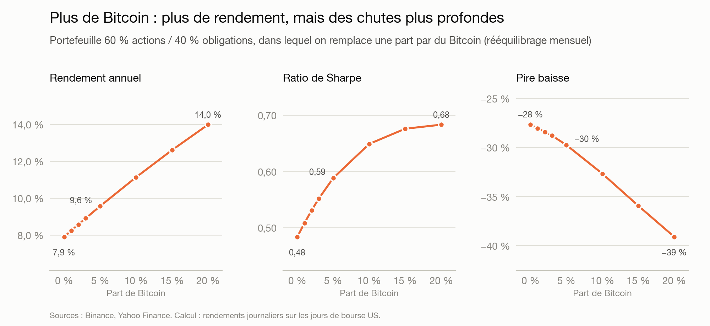

# La crypto est-elle devenue un actif comme les autres ?

Projet data de bout en bout : je compare le Bitcoin, l'Ethereum et le Solana aux marchés classiques
(actions, obligations, or) depuis 2018, puis je teste l'intérêt d'ajouter de la crypto à un portefeuille.

<!-- Lien du dashboard en ligne et vidéo de démo à ajouter ici -->

## Ce que montrent les données

- **Lien avec la bourse : oui, depuis 2020.** Le Bitcoin bouge en partie avec la bourse américaine
  (corrélation autour de 0,4, contre 0 avant).
- **Volatilité : encore à part.** Divisée par deux depuis 2021, mais toujours plus de 2 fois celle du Nasdaq.
- **Valeur refuge : non.** Il a baissé pendant chacun des 5 krachs du S&P 500, souvent plus fort.
- **« Or numérique » : non.** Aucun lien avec l'or (corrélation autour de 0,1).
- **Dans un portefeuille 60 % actions / 40 % obligations**, 5 % de Bitcoin ont amélioré le rendement
  ajusté du risque (ratio de Sharpe de 0,48 à 0,59), mais avec des chutes plus profondes :
  ces 5 % du capital représentent environ 12 % du risque.





Le détail est dans les notebooks [`01_analyse`](notebooks/01_analyse.ipynb) et
[`02_portefeuille`](notebooks/02_portefeuille.ipynb). Ce n'est pas un conseil d'investissement.

## Le dashboard

Une application Streamlit en cinq sections : vue d'ensemble, lien avec la bourse, risque et krachs,
simulateur de portefeuille, et cryptomonnaies tendance du jour (CoinGecko).
Elle existe en français et en anglais (`?lang=en` à la fin de l'adresse).

## Comment ça marche

```
Binance, Yahoo Finance, CoinGecko
        │  collecte Python
        ▼
     DuckDB ──▶ dbt (modèles SQL + 34 tests qualité) ──▶ notebooks et dashboard
```

Chaque jour, **GitHub Actions** relance la collecte, la transformation et les tests, puis publie les
données du dashboard. Si un test échoue, rien n'est publié et le dashboard garde les données de la veille.

**Outils :** Python (pandas), SQL, DuckDB, dbt, Plotly, Streamlit, GitHub Actions.

## Points notables

- **Aligner crypto et bourse** : la crypto cote 7 jours sur 7, la bourse 5 sur 7. Joindre les deux
  naïvement sur la date fait disparaître les week-ends et sous-estime la volatilité du Bitcoin
  (59 % par an au lieu de 65 %). Le projet utilise un calendrier commun.
- **Krachs détectés automatiquement** (baisse de plus de 10 % du S&P 500) plutôt que choisis à la main.
- **Simulations prudentes** : frais à chaque rééquilibrage, et résultat vérifié sur 70 périodes de 3 ans.
- **Tests qualité** : pas de doublon, prix cohérents, aucun jour manquant, données récentes.

## Organisation

```
src/          collecte des données et calculs d'analyse
transform/    modèles SQL et tests (dbt)
notebooks/    analyses détaillées
app/          dashboard Streamlit
.github/      mise à jour quotidienne automatique
```
